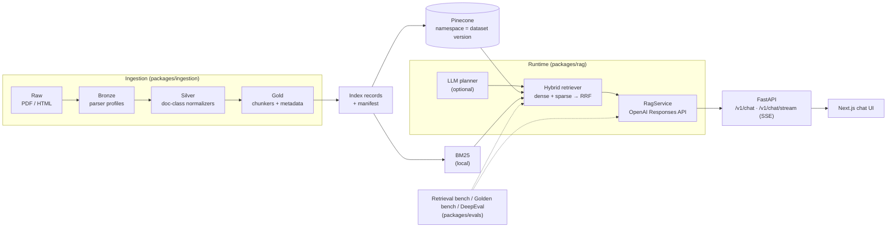

# NTU Dual Guide

> A RAG system that answers questions about the **Computer Science × Economics dual-degree program at National Taiwan University (NTU)**. I built the whole pipeline: data ETL, versioned indexing, hybrid retrieval, benchmark-driven evaluation and a streaming chat UI.


## Motivation

Dual-degree rules are spread across department websites, PDF regulations, freshman handbooks and FAQs, and they **change every academic year**. General-purpose LLMs often mix up rules from different years or departments, or make up answers.

This project grounds every answer in a **specific document, version and chunk**. When the evidence isn't there, it answers "I don't know." Every change to retrieval or prompts is measured against benchmarks.

## Highlights

- **Hybrid retrieval** combining Pinecone dense search and local BM25 through weighted Reciprocal Rank Fusion. On a 53-case retrieval benchmark, it raised **Hit@10 from 0.585 to 0.717 (+22.6%)**, **MRR from 0.545 to 0.722 (+32.5%)** and **Group Recall@10 from 0.668 to 0.836**.
- **LLM query decomposition.** An LLM planner splits a question into sub-queries and infers the academic year and department scope. Those scopes become metadata filters, which helps on cross-year and cross-department comparison questions.
- **Layered evaluation**
  - **Retrieval bench** (53 cases in three groups: single-fact, multi-fact-compare and misleading) scores the retriever alone.
  - **Golden bench** (63 cases) uses deterministic checks for answer status, required facts and source/chunk hits.
  - **DeepEval** uses an LLM as the judge to score answer quality, faithfulness and hallucination.

## Architecture



For more design detail, see [docs/architecture.md](docs/architecture.md).

## Retrieval Experiments

These runs use dataset `2026-04-25.001` and the 53-case benchmark. The full analysis is in [docs/retrieval_experiment_summary_2026-04-25.md](docs/retrieval_experiment_summary_2026-04-25.md).

| Retriever | Hit@1 | Hit@10 | Group Recall@10 | MRR |
|---|---:|---:|---:|---:|
| Dense (Pinecone, top 10) | 0.377 | 0.585 | 0.668 | 0.545 |
| Hybrid RRF (pool 10 → final 10) | 0.453 | 0.604 | 0.714 | 0.660 |
| **Hybrid RRF (pool 50 → final 10)** (current default) | **0.472** | 0.717 | **0.836** | **0.722** |
| LLM-decomposed + scope filter + coverage-aware fusion | 0.415 | **0.736** | 0.805 | 0.670 |

What the results show:

- **Ranking was the bottleneck, not recall.** Dense retrieval already finds the answer within its top 50 in 84.9% of cases (Hit@50 = 0.849). Widening the hybrid candidate pool to 50 before cutting to the final 10 gave the largest gain.
- **Scope filters keep general chunks.** A filter matches the specific value *or* `all` (for example `year_scope ∈ {112, all}`). This narrows results to a year or department while still returning general FAQ and policy chunks.
- **Query decomposition helps comparisons but is less stable.** It raised Hit@10 on comparison questions from 0.200 to 0.533, but the planner is nondeterministic. The next step is to cache planner outputs so fusion strategies can be compared on their own.

## Tech Stack

| Layer | Technology |
|---|---|
| ETL / Backend | Python 3.10+, FastAPI, uv |
| LLM / Embedding | OpenAI Responses API (`gpt-5-mini`), `text-embedding-3-small` |
| Retrieval | Pinecone (dense), BM25 (sparse), Reciprocal Rank Fusion |
| Evaluation | Custom retrieval and golden benches, DeepEval |
| Frontend | Next.js 16, React 19, Tailwind CSS 4 |

## Quick Start

```bash
# 1. Install dependencies
uv sync

# 2. Create a .env file in the repo root with OPENAI_API_KEY, PINECONE_API_KEY,
#    PINECONE_INDEX_HOST, RAG_DATASET_VERSION, etc. (full list in packages/rag/README.md)

# 3. Download the source documents into data/raw/ (see "Source Data" below)
python3 scripts/fetch/fetch_raw.py

# 4. Build the dataset and index
python3 scripts/etl/raw_to_bronze.py    --dataset-version 2026-04-25.001
python3 scripts/etl/bronze_to_silver.py --dataset-version 2026-04-25.001
python3 scripts/etl/silver_to_gold.py   --dataset-version 2026-04-25.001
python3 scripts/index/gold_to_index_records.py --dataset-version 2026-04-25.001
python3 scripts/index/upsert_pinecone.py       --dataset-version 2026-04-25.001

# 5. Start the API and the frontend
.venv/bin/uvicorn apps.api.main:app --reload
cd apps/web && npm install && npm run dev

# 6. Run the evaluations
python3 scripts/eval/eval_retrieval_bench.py --retriever hybrid --top-k 10 --dense-top-k 50 --sparse-top-k 50
.venv/bin/python scripts/eval/eval_deepeval.py --mode rag
```

## Source Data

Source documents (`data/raw/`) and intermediate artifacts are not in git. The repo tracks only pipeline code, configs, manifests and benchmarks. `scripts/fetch/fetch_raw.py` downloads all 58 source documents into `data/raw/`:

| Source | Files | How it's fetched |
|---|---:|---|
| Required-course and credit tables, academic years 110–114, CSIE and Economics ([NTU curriculum site](https://curri.aca.ntu.edu.tw/)) | 50 HTML | Scraped by `fetch_required_courses.py` and `fetch_credit_required.py` |
| Economics dual-degree regulations (academic years 111–115), dual-degree FAQ, NTU registrar rules, Economics admissions page | 8 PDF / HTML | Collected by hand and mirrored to [a public Google Drive folder](https://drive.google.com/drive/folders/1OzPoFpoHOW788gPTNMOxmDl039We1qDm) |

The curriculum site is scraped live, so its pages may differ from the snapshot behind the results above. The stage manifests in `data/manifests/` record a `source_hash` for every processed document, so you can check whether your downloaded copy matches.

## Project Structure

```text
.
├── apps/
│   ├── api/            # FastAPI: /v1/chat, /v1/chat/stream (SSE)
│   └── web/            # Next.js streaming chat UI
├── packages/
│   ├── ingestion/      # bronze/silver/gold routers, normalizers, chunkers, index records
│   ├── rag/            # retrievers (dense / BM25 / hybrid / LLM-decomposed), prompts, RagService
│   └── evals/          # retrieval bench, golden bench, DeepEval runner, datasets
├── scripts/            # fetch / etl / index / eval / rag CLIs
├── configs/            # pipeline and source configs
├── data/manifests/     # snapshot manifests for each dataset version
└── docs/               # architecture notes and experiment reports
```

## Future Work

The next experiment will cache the planner's sub-queries so that fusion strategies (plain RRF, coverage-aware RRF and per-subquery quotas) can be compared without planner nondeterminism affecting the results. After that, I plan to add a cross-encoder reranker, package the services with Docker for cloud deployment, and collect user feedback to grow the golden bench.
