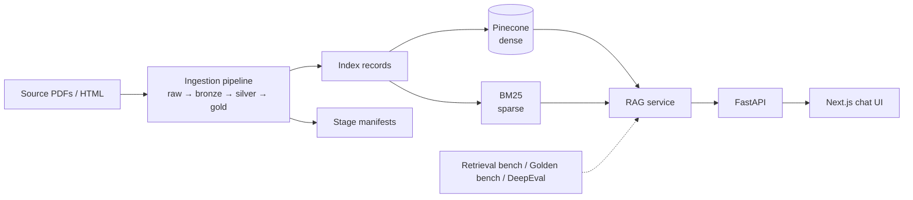

# Architecture

## 1. Goals

The system answers questions about the NTU Computer Science × Economics dual-degree program. Every answer must be traceable to specific documents, so the design prioritizes three properties:

- **Traceability**: each answer maps back to a document, a dataset version and a chunk.
- **Reproducibility**: any index can be rebuilt from a dataset snapshot.
- **Measurability**: changes to chunking, embeddings, prompts or retrieval are compared against versioned benchmarks.

## 2. System Overview



## 3. Module Boundaries

| Module | Responsibility | Does not handle |
|---|---|---|
| `packages/ingestion` | Parsing, normalization, chunking, index records and Pinecone upserts | User requests |
| `packages/rag` | Retrieval, prompting, answer generation and citations | HTTP transport, ETL |
| `packages/evals` | Benchmark datasets and evaluation runners | Production serving |
| `apps/api` | HTTP and SSE transport over the RAG service | Retrieval or prompt logic |
| `apps/web` | Streaming chat UI with retrieval progress and citations | Business logic |

Route handlers never construct retrievers, prompts or index clients directly. They call `RagService`, which keeps the RAG layer reusable from the API, the CLI and the evaluation runners.

The core data models (`BronzeDocument`, `SilverDocument`, `GoldChunk`, `RetrievalChunk`, `ChatAnswer`) and the `Retriever` protocol are defined in this repository rather than borrowed from an orchestration framework, so the LLM, embedding model and vector database can each be swapped independently.

## 4. Data Pipeline

### Medallion layers

| Layer | Contents |
|---|---|
| `raw` | Original PDF and HTML files, unchanged |
| `bronze` | Generic parser output, without domain-specific schema |
| `silver` | Canonical schema per document class, produced by class-specific normalizers |
| `gold` | Retrieval-ready chunks with enrichment metadata |

The layers live on the local file system and can move to object storage without code changes.

### Document classes

Source documents differ greatly in structure, so each class has a dedicated normalizer and chunker instead of a single fixed-size splitter:

| Document class | Chunking strategy |
|---|---|
| Dual-degree policy (PDF) | An overview chunk plus one chunk per regulation section |
| Required-course tables (HTML) | Per-course chunks plus a course-list chunk per year and grade |
| Credit requirement tables (HTML) | An overview chunk plus chunks for per-term credit limits and notes |
| FAQ | One chunk per question-answer pair |
| Other source-specific pages | By heading section |

### Pipeline run

1. Fetch source documents into `data/raw/` (`scripts/fetch/fetch_raw.py`).
2. Run each stage with an explicit `--dataset-version`; each stage writes to `data/<layer>/<dataset_version>/`.
3. Each stage writes a manifest recording every document's `source_hash` and processing fingerprint.
4. Build index records from gold chunks and embed them with `text-embedding-3-small`.
5. Upsert to the Pinecone namespace that matches the dataset version.

## 5. Versioning

Git tracks pipeline code, source configs, stage manifests, benchmark datasets and schema definitions. Source documents and intermediate artifacts stay outside git.

Every index record carries the metadata needed to trace it back to its source:

| Field | Purpose |
|---|---|
| `dataset_version` | Snapshot the record belongs to |
| `source_id`, `doc_type`, `title` | Source document identity |
| `source_hash` | Hash of the raw source file |
| `silver_processing_fingerprint`, `gold_processing_fingerprint` | Code and config version that produced the chunk |
| `chunk_type`, `chunk_order`, `section_id`, `heading` | Position and type of the chunk within the document |
| `year_scope`, `department_scope` | Academic year and department the chunk applies to (`all` when general) |
| `authority_level`, `language` | Source authority and language |

Principles:

- `dataset_version` is a first-class identifier and is not inferred from the Pinecone namespace name.
- Any answer can be traced through `dataset_version → source_id → source_hash`.
- Changes to parsing, chunking or embeddings produce a new dataset version, so old and new quality can be compared side by side.

Manifests and content hashes are sufficient at the current scale. A tool such as DVC becomes worthwhile once several people rebuild datasets frequently, or large artifacts need to be synced across environments.

## 6. Vector Index

- **Index boundary**: one index per embedding model and dimension. Changing the embedding model creates a new index, so vectors from different models never mix.
- **Namespace boundary**: one namespace per dataset version. Old snapshots remain available for A/B comparison and rollback.
- **Metadata filters**: `year_scope` and `department_scope` narrow retrieval to a specific academic year or department. A filter on a concrete value also matches `all`, so general FAQ and policy chunks remain visible:

```python
{
    "year_scope": {"$in": ["112", "all"]},
    "department_scope": {"$in": ["3030", "all"]},
}
```

## 7. Retrieval

| Retriever | Description |
|---|---|
| `dense` | OpenAI embeddings with Pinecone similarity search |
| `hybrid` (default) | Dense and BM25 candidate pools fused with weighted Reciprocal Rank Fusion |
| `hybrid_promoted` | Hybrid retrieval followed by deterministic promotion of related chunks |
| `llm_decomposed` | An LLM planner splits the question into sub-queries with year and department scopes, then fuses per-sub-query results |

The BM25 index is built in-process from the same `records.jsonl` that was upserted to Pinecone, so dense and sparse retrieval always see the same snapshot. Experiment results are in [retrieval_experiment_summary_2026-04-25.md](retrieval_experiment_summary_2026-04-25.md).

## 8. Request Path

1. The API receives a question on `/v1/chat` or `/v1/chat/stream`.
2. `RagService` runs the configured retriever.
3. If no chunk passes the relevance threshold, the service answers that it does not know.
4. Otherwise, it builds a prompt from the retrieved chunks and calls the OpenAI Responses API.
5. The response returns the answer, citations, retrieved chunks, model and dataset version.

The streaming endpoint emits `stage`, `retrieved`, `reasoning`, `token` and `final` events over Server-Sent Events. The Next.js app proxies the stream and renders retrieval progress, the answer as it is generated, and its citations.

## 9. Evaluation

The benchmarks are versioned quality assets, separate from the ETL pipeline. Evaluation is layered so that a regression points to the layer that caused it:

| Layer | Question it answers |
|---|---|
| Retrieval bench | Did the retriever return the required evidence? |
| Golden bench | Does the end-to-end answer have the right status, facts and sources? |
| DeepEval | Is the generated answer relevant, faithful to the context and free of hallucination? |

Benchmark cases cover single-fact lookups, cross-year and cross-department comparisons, misleading questions, and questions whose answer is not in the corpus.

### Planned CI

| Trigger | Checks |
|---|---|
| Pull request | Lint, type check, unit tests, retrieval smoke eval |
| Merge to `main` | Build image, deploy to staging, full benchmark |
| Nightly | Regression eval against the latest snapshot |

## 10. Observability (Planned)

Each request should record the query, answer ID, top-k chunk IDs, dataset version, latency, token usage and user feedback. Keeping these in one place makes it straightforward to add Langfuse or OpenTelemetry later.
