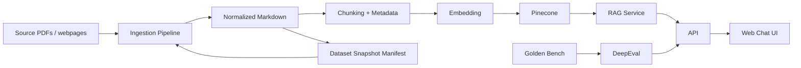

# Architecture

## 1. 目標

這個專案的核心任務是回答「台大資工雙主修經濟系」相關問題，而且答案要能追溯到明確文件事實。這代表系統設計要優先解決三件事：

- 資料可追溯：回答能對應到文件、版本、chunk。
- 可重建：任何 index 都能由某個 dataset snapshot 重新生成。
- 可評測：改 chunking、embedding、prompt、retriever 後能回歸比較。

## 2. 整體架構

## 3. 模組邊界

### `packages/ingestion`

負責 ETL 與 indexing，不處理使用者聊天請求。

建議拆成以下子模組：

- `connectors/`: 下載來源文件，像 PDF、HTML、公告頁。
- `parsers/`: PDF/HTML 轉 markdown。
- `normalizers/`: 清理頁首頁尾、重複段落、表格或 OCR 雜訊。
- `chunkers/`: 依文件型別套不同 chunking 規則。
- `embedders/`: 封裝 embedding model 與 batch upsert。
- `indexers/`: 寫入 Pinecone 與同步 metadata。
- `manifests/`: 產出 dataset snapshot。

### `packages/rag`

負責 runtime 問答流程。

- `retrieval/`: Pinecone 查詢、metadata filter、hybrid retrieval 預留接口。
- `ranking/`: reranking 預留接口；一開始可先不開。
- `prompts/`: 系統 prompt、citation prompt、fallback prompt。
- `services/`: `answer_question()` 等核心應用服務。
- `schemas/`: query / answer / citation / context chunk schema。

### `packages/evals`

負責 Golden Bench 與回歸評測，不要混進 production API。

- `datasets/`: 版本化 golden set，建議用 `jsonl`。
- `generators/`: 用人工題目 + LLM 擴增候選題，再人工審核。
- `runners/`: DeepEval runner。
- `reports/`: 輸出 PR 與 nightly benchmark 結果。

### `apps/api`

對外只提供 transport layer，不把 retrieval 細節散在 route handler。

建議包含：

- `POST /chat`
- `POST /feedback`
- `GET /health`
- `GET /version`
- `POST /admin/reindex` 或改成 queue/cron 觸發

### `apps/web`

簡單 chat UI 即可，重點是 citation 與可用性。

- 顯示答案與引用片段
- 顯示來源文件標題 / URL / 更新日期
- 支援「答案不夠準」回饋

## 4. 推薦資料流

### ETL 四層

- `raw`: 原始下載檔案，保留 PDF/HTML 原貌。
- `bronze`: 解析後原始 markdown，不做太多語意修正。
- `silver`: 清洗與標準化後可供 chunking 的 markdown。
- `gold`: chunk metadata、embedding job manifest、eval-ready dataset。

這四層可以先放本機檔案系統，未來平移到 object storage。

### 單次 pipeline

1. 下載/更新來源文件。
2. 對每份文件計算 `content_hash`。
3. 若 hash 未變，不重跑 parse/chunk/embed。
4. 產出 markdown 與標準化 metadata。
5. 依文件型別 chunking。
6. 產出 chunk manifest。
7. 執行 embedding。
8. upsert 至 Pinecone。
9. 產生 dataset snapshot manifest，記錄這次 index 使用了哪些文件版本。

## 5. 資料版本控制

這裡不建議把「資料版本控制」等同於「把所有 PDF 放進 git」。比較穩的做法是：

- Git 追蹤：
  - pipeline code
  - source config
  - dataset snapshot manifest
  - golden bench
  - schema 定義
- Object storage / local storage 儲存：
  - 原始 PDF / HTML
  - 轉換後 markdown
  - 中間 artifacts

### 推薦版本策略

每份文件至少帶以下欄位：

- `source_id`: 例如 `ntu-csie-dual-major-regulation`
- `doc_id`: 穩定文件 ID
- `doc_version`: 可用時間戳或 hash-based version
- `source_url`
- `content_hash`
- `fetched_at`
- `effective_date`
- `parser_version`
- `chunking_version`

每個 chunk 至少帶：

- `chunk_id`
- `doc_id`
- `doc_version`
- `chunk_index`
- `chunk_text`
- `section_path`
- `dataset_version`
- `embedding_model`
- `embedding_version`
- `language`

### 關鍵原則

- `dataset_version` 要獨立存在，不要只依賴 Pinecone namespace 名稱。
- 任何回答都應能追到 `dataset_version -> doc_version -> content_hash`。
- 改 parser / chunking / embedding 時，版本號要變，讓你能對照新舊品質。

### 是否用 DVC

如果你現在是一人開發、資料量中等、來源多為官方 PDF，我不建議一開始就把 DVC 當必需品。先用「manifest + object storage path + content hash」就夠，而且比較不會把流程綁死。

等到出現以下情況再加 DVC 或 lakehouse 工具：

- 多人協作頻繁重建資料集
- 需要跨環境同步大型 artifacts
- 需要正式追蹤多個資料快照與 lineage

## 6. Pinecone 規劃

不要把所有東西塞進單一 index。

建議策略：

- `index` 以 embedding model family / dimension + environment 為邊界
- `namespace` 以 dataset 或 tenant 為邊界
- metadata filter 用於 `department=csie|econ`, `doc_type=regulation|faq|announcement`

一個可行範例：

- `ntu-dual-guide-dev-openai-large`
- `ntu-dual-guide-prod-openai-large`

namespace 例子：

- `main`
- `2026-04-14-snapshot`

這樣的好處是：

- 換 embedding model 時不會互相污染
- dev/staging/prod 易於隔離
- 可以保留舊 snapshot 做 A/B 或回滾

## 7. LlamaIndex 的角色

可以用，但不要讓業務邏輯直接依附在 framework object graph。

建議把 LlamaIndex 用在：

- ingestion pipeline orchestration
- Pinecone vector store adapter
- retriever integration
- response synthesizer

不要直接把系統綁死在：

- LlamaIndex 專屬文件 schema 當內部唯一資料模型
- route handler 直接 new retriever / prompt / index object

比較好的做法是你自己定義：

- `DocumentRecord`
- `ChunkRecord`
- `DatasetSnapshot`
- `AnswerResult`

外層再把這些映射到 LlamaIndex。

## 8. 後端設計

推薦 `FastAPI + service layer`。

### request path

1. API 收到問題
2. 做 query normalization
3. 呼叫 `RAGService`
4. `RAGService` 執行 retrieval
5. 若需要則 rerank
6. 組 prompt 並產生答案
7. 回傳答案、citations、retrieval metadata
8. 同步記錄 trace / feedback / latency

### 後端應留下的 observability

- query text
- answer id
- top-k chunk ids
- dataset version
- latency
- token usage
- user feedback

後期如果要接 Langfuse / OpenTelemetry，也比較容易。

## 9. 前端設計

前端不需要花俏，但要有以下元素：

- 對話區
- 引用來源卡片
- 回答信心或 fallback 提示
- 問題建議 chips
- feedback buttons

若你想快速做 MVP，`Next.js` 很合適；若你只要極簡，也可以單純 React + Vite。這裡我傾向 `Next.js`，因為未來要接 auth、server actions、部署平台通常更順。

## 10. Golden Bench 與 DeepEval

Golden Bench 不應視為 ETL 附屬物，而應該是獨立的品質資產。

建議把它切成兩類：

- `seed set`: 人工撰寫的高價值題目，數量少但品質高
- `synthetic set`: 由 LLM 從文件生成候選問答，再人工篩選

### benchmark 題目分類

- 規章判讀
- 資格限制
- 學分與課程要求
- 申請流程與時間點
- 例外條款
- 跨文件整合問答
- 拒答 / 資訊不足

### CI 中怎麼跑

- PR:
  - lint / typecheck / unit tests
  - 小型 eval smoke test
- merge to main:
  - build image
  - deploy staging
  - 跑完整 benchmark
- nightly:
  - 對最新 staging/prod snapshot 跑回歸 eval

## 11. 建議 repo contract

### 來源設定檔

每個來源都應該是 config-driven，而不是散落在程式裡。

至少包含：

- `source_id`
- `source_type`
- `url`
- `crawl_policy`
- `parser`
- `chunking_profile`
- `tags`

### chunking profile

不要只有一種 chunk size。規章、FAQ、公告頁的切法應不同。

- regulation: 依章節標題優先切
- faq: Q/A 配對切
- announcement: 依日期與主題切

## 12. 建議開發順序

1. 先定 schema，不先寫 UI。
2. 先完成單一來源到 Pinecone 的最小 ETL。
3. 再做 retrieval + citation answer。
4. 接著做 Golden Bench。
5. 最後補前端與部署自動化。

## 13. 初始實作建議

第一版不要急著做：

- agent workflow
- multi-hop planning
- complicated memory
- 多模型路由

先把以下做到穩：

- 文件版本化
- citation quality
- answer refusal
- eval regression
- 可重建 index

## 14. 建議下一步

如果你要我直接繼續往下做，最合理的順序是：

1. 先建立 Python monorepo 與 `FastAPI`/`LlamaIndex` package skeleton。
2. 補 `DocumentRecord`、`ChunkRecord`、`DatasetSnapshot` schema。
3. 寫第一條 ETL pipeline stub。
4. 補 GitHub Actions 與 DeepEval runner skeleton。
